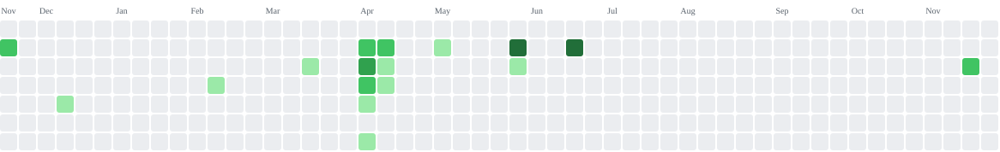

<div align="center">


<p><b>POS · E-Invoicing · Excise Tax · Logistics · Multi-Tenant SaaS · DevOps</b><br/>
<sub>Addis Ababa, Ethiopia 🇪🇹 · Senior Engineer &amp; Solution Architect @ ChinetPlus Technology Solutions</sub></p>

<p>
  <a href="https://www.linkedin.com/in/michael-wondemu-2a3849199/"></a>
  <a href="https://michael.kachamale.com"></a>
  <a href="mailto:michaelwondemu195@gmail.com"></a>
</p>

<p>
  
  
  
  
</p>

</div>

<br/>

## ⭐ Highlights

> I build and run software that businesses depend on to make money: point of sale, e-invoicing, tax compliance, hospitality and logistics. I also own the DevOps that keeps it running in production.

<table>
<tr>
<td width="25%" valign="top" align="center">

### 🍽️ YeneMenu
Multi-tenant QR digital menus for restaurants and hotels, with real-time ordering notifications and search.<br/><br/>
<sub>`NestJS` `React` `MongoDB` `RabbitMQ` `Socket.IO`</sub>

</td>
<td width="25%" valign="top" align="center">

### 🏪 POS & Retail
Multi-branch POS with offline-first sync, inventory, loyalty and reconciliation.<br/><br/>
**4+ branches live on day one · 0 critical incidents**

</td>
<td width="25%" valign="top" align="center">

### 🧾 E-Invoicing & Tax
E-invoice generation, validation and tax-authority submission, plus excise digital stamps.<br/><br/>
**Government regulatory sign-off**

</td>
<td width="25%" valign="top" align="center">

### ⚙️ DevOps & Cloud
CI/CD, Docker Swarm and Linux/Nginx production releases for every product.<br/><br/>
**Deploys: ~4h → &lt;20 min**

</td>
</tr>
</table>

## 👋 About Me

<table>
<tr>
<td width="58%" valign="top">

I'm a **Senior Full-Stack Engineer & Solution Architect** at **ChinetPlus Technology Solutions**. I design and lead enterprise platforms for logistics, taxation, retail and government.

- 🏗️ **Architecture:** event-driven microservices, multi-tenant SaaS, DDD, CQRS
- 🧾 **Products:** POS, e-invoicing, excise tax, TMS, ERP and e-procurement
- 🔐 **Security:** zero-trust IAM with OAuth2, JWT, WebAuthn, MFA and RBAC
- ⚙️ **Delivery:** reusable NestJS monorepo frameworks, CI/CD, Docker Swarm
- 🏛️ **Scale:** core engineer on Ethiopia's **National ePROCURE** (50+ agencies)
- 🎓 **Teaching:** 7 years lecturing CS and mentoring 100+ engineers
- 🌱 **Exploring:** distributed systems, cloud-native patterns, AI-augmented backends

</td>
<td width="42%" valign="top">

```typescript
const michael = {
  role: "Solution Architect",
  base: "Addis Ababa, ET 🇪🇹",
  edu:  "MSc Software Eng. (AASTU)",
  stack: [
    "TypeScript", "NestJS",
    "Next.js", "PostgreSQL",
    "Go", "Docker",
  ],
  principles: {
    architecture: "Clean + DDD + CQRS",
    security:     "Zero-trust by default",
    delivery:     "Automate everything",
  },
} as const;
```

</td>
</tr>
</table>

## 🛠️ Tech Stack

<div align="center">

<table>
<tr><td align="center"><b>Languages</b></td><td></td></tr>
<tr><td align="center"><b>Backend</b></td><td></td></tr>
<tr><td align="center"><b>Frontend</b></td><td></td></tr>
<tr><td align="center"><b>Data &amp; Messaging</b></td><td></td></tr>
<tr><td align="center"><b>DevOps</b></td><td></td></tr>
</table>


</div>

## 🧭 How I Build Platforms

A reference architecture I reuse across my enterprise products:

<div align="center">

<table>
<tr>
<td align="center"><b>Clients</b><br/><sub>Web · Mobile · POS terminals</sub></td>
<td align="center">➜</td>
<td align="center"><b>API Gateway</b><br/><sub>Nginx · rate limiting</sub></td>
<td align="center">➜</td>
<td align="center"><b>IAM</b><br/><sub>OAuth2 · JWT · MFA · WebAuthn · RBAC</sub></td>
</tr>
<tr>
<td align="center" colspan="5">⬇</td>
</tr>
<tr>
<td align="center"><b>Domain Services</b><br/><sub>NestJS · DDD · CQRS</sub></td>
<td align="center">⇄</td>
<td align="center"><b>Event Bus</b><br/><sub>RabbitMQ</sub></td>
<td align="center">⇄</td>
<td align="center"><b>Workers</b><br/><sub>Billing · E-invoice · Notifications</sub></td>
</tr>
<tr>
<td align="center" colspan="5">⬇</td>
</tr>
<tr>
<td align="center"><b>PostgreSQL</b><br/><sub>tenant-isolated</sub></td>
<td></td>
<td align="center"><b>Redis</b><br/><sub>cache · sessions</sub></td>
<td></td>
<td align="center"><b>ElasticSearch · Audit Log</b><br/><sub>search · compliance</sub></td>
</tr>
</table>

<sub>Shipped with GitHub Actions → Docker Swarm → Linux/Nginx</sub>

</div>

## 🚀 Featured Projects

<table>
<tr>
<td width="50%" valign="top">

### 🍽️ YeneMenu
Multi-tenant QR digital menus with real-time push and search.<br/>
**Impact:** event-driven DDD design with ElasticSearch discovery.<br/>
<sub>`NestJS` `React` `MongoDB` `RabbitMQ` `Socket.IO`</sub>

</td>
<td width="50%" valign="top">

### 🏪 POS & Retail Platform
Multi-branch POS, inventory, loyalty and offline-ready sync.<br/>
**Impact:** 4+ branches went live together with zero critical incidents.<br/>
<sub>`NestJS` `Next.js` `PostgreSQL` `CQRS` `Docker`</sub>

</td>
</tr>
<tr>
<td width="50%" valign="top">

### 🔖 Excise Tax & Digital Stamp System
Stamp lifecycle, serialisation, QR/barcode verification and anti-counterfeiting.<br/>
**Impact:** government regulatory sign-off; full product traceability.<br/>
<sub>`NestJS` `TypeScript` `PostgreSQL` `QR/Barcode`</sub>

</td>
<td width="50%" valign="top">

### 🔐 Enterprise IAM Platform
Multi-tenant OAuth2, JWT, MFA, WebAuthn, RBAC and audit logging.<br/>
**Impact:** 0 critical security findings across all deployments.<br/>
<sub>`OAuth 2.0` `WebAuthn` `NestJS` `Docker Swarm`</sub>

</td>
</tr>
<tr>
<td width="50%" valign="top">

### 🏛️ National ePROCURE
Ethiopia's government e-procurement: e-tendering, vendors and contracts.<br/>
**Impact:** 50+ agencies; queries ~60% faster (900ms → 350ms).<br/>
<sub>`C#` `.NET` `PostgreSQL` `Angular` `Redis`</sub>

</td>
<td width="50%" valign="top">

### 🚛 Transportation Management System
Fleet ops, dispatching, trip management, real-time tracking and billing.<br/>
**Impact:** live with 5+ operational clients, delivered on schedule.<br/>
<sub>`NestJS` `TypeScript` `PostgreSQL` `Next.js` `Docker`</sub>

</td>
</tr>
<tr>
<td width="50%" valign="top">

### 🧾 E-Invoicing Platform
Electronic invoices: generation, validation, digital signing and submission to the tax authority.<br/>
**Impact:** compliant invoicing built into POS and ERP workflows.<br/>
<sub>`NestJS` `TypeScript` `PostgreSQL` `REST APIs` `Docker`</sub>

</td>
<td width="50%" valign="top">

### ⚙️ DevOps & Release Platform
Shared CI/CD, containerised deployments and production infrastructure for all products.<br/>
**Impact:** deploys went from ~4h to under 20 min, with 35% faster releases.<br/>
<sub>`GitHub Actions` `Docker Swarm` `Linux` `Nginx`</sub>

</td>
</tr>
</table>

<details>
<summary><b>More projects</b></summary>
<br/>

| Project | What it does | Stack |
|---|---|---|
| 🛒 **E-Commerce Optimisation** | ~65% faster search; ML recommendations gave +20% engagement | `NestJS` `Next.js` `PostgreSQL` `Redis` `CQRS` |
| 📝 **YeneGetse CMS** | Multi-language CMS for Ethiopian languages with SMS notifications | `NestJS` `React` `PostgreSQL` `Redis` |

</details>

## 💼 Experience

<details open>
<summary><b>ChinetPlus Technology Solutions</b> · Senior Full-Stack Engineer & Solution Architect · <i>Jan 2025 – Present</i></summary>
<br/>

Designing and leading enterprise platforms for government and private-sector clients.

**What I build here**

- 🏪 **POS & Retail:** multi-branch point of sale, inventory, loyalty, offline-first sync and sales reconciliation
- 🧾 **E-Invoicing:** electronic invoice generation, validation and submission to tax authorities, with audit trails and reporting
- 🔖 **Excise Tax & Digital Stamps:** stamp lifecycle, serialisation and QR/barcode verification
- 🚛 **Transportation Management:** fleet, dispatch, trip tracking and billing
- 🔐 **IAM:** multi-tenant OAuth2, JWT, MFA, WebAuthn and RBAC
- ⚙️ **DevOps:** CI/CD pipelines in GitHub Actions, Docker and Docker Swarm, Linux/Nginx servers, monitoring and zero-downtime releases

| Metric | Result | How |
|---|---|---|
| Boilerplate | **~40% less** | Reusable NestJS monorepo framework (DDD + Clean Architecture) |
| Deployments | **35% faster** | Standardised CI/CD, Docker Swarm, Linux/Nginx |
| Audit trail | **100% coverage** | RBAC and audit logging on every transaction |
| Security | **0 critical findings** | OAuth2, JWT, WebAuthn and MFA security layer |

</details>

<details>
<summary><b>Kachamale Technologies</b> · Senior Full-Stack Engineer · <i>Jan 2023 – Dec 2024</i></summary>
<br/>

Led multi-tenant SaaS products: inventory, CRM, workflow automation and document generation.

| Metric | Result | How |
|---|---|---|
| Boilerplate | **~40% less** | Shared NestJS framework across 5 SaaS products |
| Time to production | **30% faster** | Event-driven microservices and a Redis caching layer |
| Deploy time | **~4h → <20min** | GitHub Actions, Docker and Nginx automation |
| Incidents | **0 critical** | Across all multi-tenant go-lives |

</details>

<details>
<summary><b>Perago Information Systems</b> · Software Engineer · <i>Feb 2021 – Oct 2024</i></summary>
<br/>

Core engineer on Ethiopia's **National ePROCURE System**.

| Metric | Result | How |
|---|---|---|
| Reach | **50+ agencies** | Vendor management, e-tendering, contract management |
| Query speed | **~60% faster** | PostgreSQL indexing and Redis caching (900ms → 350ms) |
| Team throughput | **+25%** | API gateway standards, coding guidelines, architecture playbook |
| Security audit | **0 critical findings** | OAuth 2.0, JWT, RBAC, AES encryption |

</details>

<details>
<summary><b>Woldia University</b> · Lecturer, CS & Software Engineering · <i>2018 – 2025</i></summary>
<br/>

- Taught software engineering, data structures and algorithms for 7 academic years
- Mentored **100+ students** entering Ethiopia's tech sector

</details>

## 📊 GitHub Analytics

<div align="center">


</div>

## 🎮 Contribution Arcade

<div align="center">

<sub>Built from my real contribution graph and refreshed every 12 hours.</sub>

**🚀 Galaga**

<picture>
  <source media="(prefers-color-scheme: dark)" srcset="https://raw.githubusercontent.com/MichaelWondemuu/MichaelWondemuu/output/galaga-contribution-graph-dark.svg" />
  <source media="(prefers-color-scheme: light)" srcset="https://raw.githubusercontent.com/MichaelWondemuu/MichaelWondemuu/output/galaga-contribution-graph.svg" />
  
</picture>

<br/>

**🧱 Tetris**

<picture>
  <source media="(prefers-color-scheme: dark)" srcset="https://raw.githubusercontent.com/MichaelWondemuu/MichaelWondemuu/output/tetris-contribution-graph-dark.svg" />
  <source media="(prefers-color-scheme: light)" srcset="https://raw.githubusercontent.com/MichaelWondemuu/MichaelWondemuu/output/tetris-contribution-graph.svg" />
  
</picture>

<br/>

**🐍 Snake**

<picture>
  <source media="(prefers-color-scheme: dark)" srcset="https://raw.githubusercontent.com/MichaelWondemuu/MichaelWondemuu/output/snake-blue.svg" />
  <source media="(prefers-color-scheme: light)" srcset="https://raw.githubusercontent.com/MichaelWondemuu/MichaelWondemuu/output/snake.svg" />
  
</picture>

</div>

## 🏆 Impact at a Glance

<div align="center">

| ⏱️ Engineering | 🏢 Platforms | 🏛️ Agencies | 🚀 Deploys | 📈 Query speed | 🔐 Audits | 🎓 Mentored |
|:---:|:---:|:---:|:---:|:---:|:---:|:---:|
| **5+ yrs** | **7+** | **50+** | **4h → <20m** | **~60% faster** | **0 critical** | **100+** |

</div>

## 🤝 Connect

<div align="center">

<a href="https://www.linkedin.com/in/michael-wondemu-2a3849199/"></a>
<a href="https://michael.kachamale.com"></a>
<a href="mailto:michaelwondemu195@gmail.com"></a>

<br/><br/>


</div>
